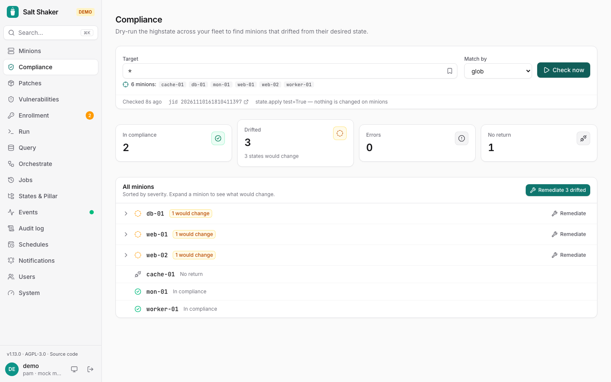

**Compliance** dry-runs the highstate (`test=True`) across a target, then groups minions into:

- **In compliance**: nothing would change.
- **Drifted**: some states would change. You see the diffs.
- **Errors**: states failed to render or run.
- **No return**: the minion didn't answer.

**Remediate** opens [Run](/salt-shaker/guide/run/) with `state.apply` prefilled for just the drifted minions, so you can review and start it.

With the server, past checks are kept, so you can follow drift over time.

## Failures

**Failures** (next to Compliance in the menu) answers "what is broken right now?" across every state run, not only compliance checks. It reads the `state.apply`, `state.highstate` and `state.sls` runs the server recorded over the last day, 3 days or 7 days, real runs and dry runs alike, and groups what failed by state and error. The same broken repository on 40 minions is one line, `pkg.installed nginx` with its error and "on 40 minions", not 40 rows to read.

- A failed state counts until a later run on that minion gets the same state through, whichever run that is.
- A run that never got to its states (an SLS that doesn't render, `No matching sls found`) counts until the same run, or a highstate, gets through.
- To compare errors, the minion's id, IP addresses, long numbers and hashes are taken out. Open a line to see each minion's own message, with its job and when it failed.

The largest groups come first. Filter by minion, state or error. **Dry run** and **Run again on N** open [Run](/salt-shaker/guide/run/) with `state.apply` of the SLS the state is in prefilled for just those minions, so you can review it before starting it. **Copy list** copies the minion ids.

Failures needs the server, which records the runs (the demo reads its simulated master). A look back reads the 500 most recent state runs at most.

## Preview a branch

With [gitfs](https://docs.saltproject.io/en/latest/topics/tutorials/gitfs.html), every branch of your states repository is a salt environment (saltenv). **Preview a branch** shows what merging one would change before you merge it: it dry-runs the highstate from the branch and from `base` on the same minions (`state.apply test=True saltenv=…`, nothing changes) and keeps only the states whose outcome differs:

- **would fail**: fails with the branch, not with base;
- **would change**: the branch would change it, base wouldn't;
- **new, would change**: a state only the branch has;
- **not applied any more**: base has it, the branch doesn't (Salt leaves what it managed in place);
- **no longer changes**: base would change it, the branch wouldn't.

A branch that doesn't render shows the error for each minion. The list of branches comes from `fileserver.envs`; operators and viewers may read it.

## Hardening checks

**Hardening checks** (linked from Compliance) runs 15 common Linux hardening checks, of the kind CIS benchmarks recommend, on a target and scores each minion by the share it passes:

| Area | Checks |
| --- | --- |
| SSH | root can't log in with a password; keys, not passwords (`PasswordAuthentication no`); no X11 forwarding |
| Accounts | only root has user id 0 |
| Files | `/etc/shadow` readable by root only; `/etc/passwd` not writable by others; no setuid programs in `/tmp`, `/var/tmp` or `/dev/shm`; `/tmp` is its own filesystem |
| Network | no IP forwarding; ICMP redirects ignored; SYN cookies on; nothing listening for telnet, FTP, TFTP or r-services |
| Kernel | full address space layout randomization |
| Services | auditd runs; the clock is kept in sync (chrony, ntpd or systemd-timesyncd) |

The checks are read with [osquery](/salt-shaker/guide/query/) in one query per minion (through `cmd.run`, so it needs that permission), and nothing on the minions changes. Minions without osquery are listed apart; the Query page installs it. The page shows the checks that fail somewhere first, with the minions that fail them, and the minions with the lowest score first. **Evidence (CSV)** saves a line per minion and check, with the result, when it was checked and the job id, for an auditor; the job itself stays in the job history.

They are a quick baseline, not a certified CIS benchmark: `sshd_config` is read without the files it includes, and IP forwarding is expected on routers and container hosts. For a full benchmark, run OpenSCAP or CIS-CAT through Salt.

