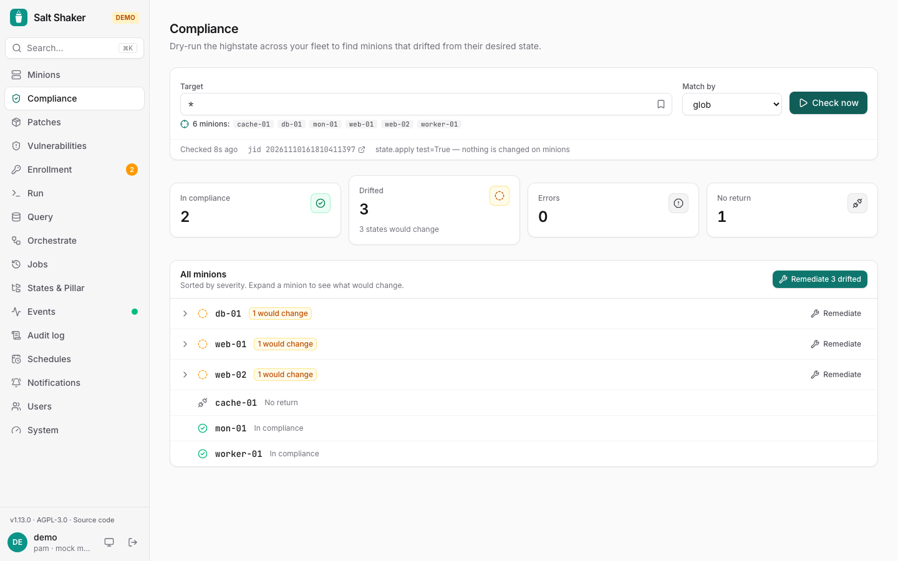

**Compliance** dry-runs the highstate (`test=True`) across a target, then groups minions into:

- **In compliance**: nothing would change.
- **Drifted**: some states would change. You see the diffs.
- **Errors**: states failed to render or run.
- **No return**: the minion didn't answer.

**Remediate** opens [Run](/salt-shaker/guide/run/) with `state.apply` prefilled for just the drifted minions, so you can review and start it.

With the server, past checks are kept, so you can follow drift over time.

## Preview a branch

With [gitfs](https://docs.saltproject.io/en/latest/topics/tutorials/gitfs.html), every branch of your states repository is a salt environment (saltenv). **Preview a branch** shows what merging one would change before you merge it: it dry-runs the highstate from the branch and from `base` on the same minions (`state.apply test=True saltenv=…`, nothing changes) and keeps only the states whose outcome differs:

- **would fail**: fails with the branch, not with base;
- **would change**: the branch would change it, base wouldn't;
- **new, would change**: a state only the branch has;
- **not applied any more**: base has it, the branch doesn't (Salt leaves what it managed in place);
- **no longer changes**: base would change it, the branch wouldn't.

A branch that doesn't render shows the error for each minion. The list of branches comes from `fileserver.envs`; operators and viewers may read it.
