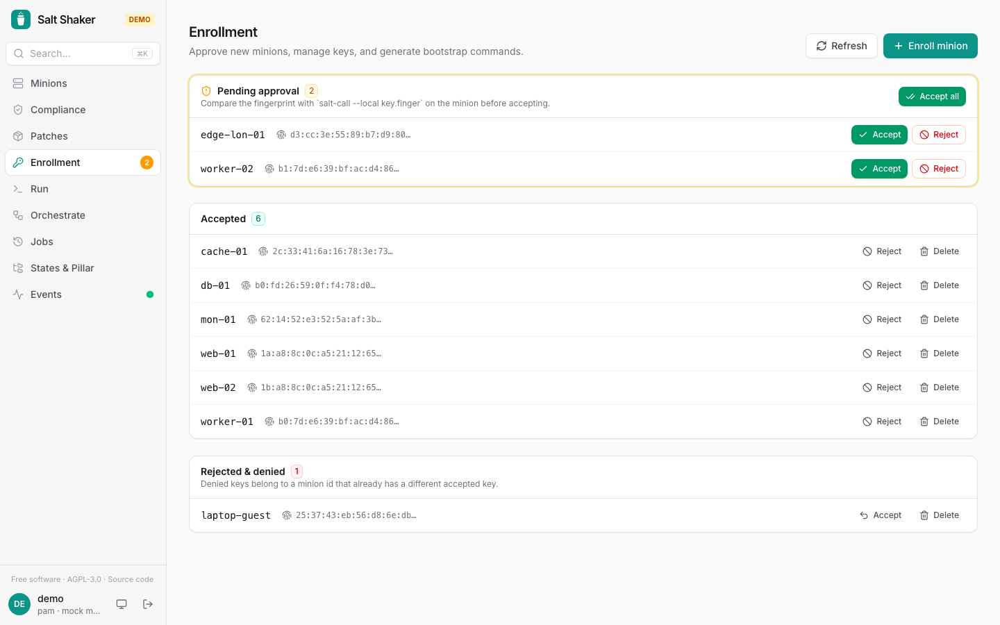

**Enrollment** lists pending, accepted, rejected and denied keys. Denied keys belong to a minion id that already has a different accepted key. Check a key's fingerprint before you accept or reject it.

It also generates bootstrap commands for new minions. With **pre-seeded keys**, the key pair is generated on the master and accepted in advance, so the new minion is trusted on first contact.

:::caution
Pre-seeded enrollment shows the minion's private key once. Copy it to the minion over a trusted channel.
:::

Managing keys needs the **admin** role.

## Enrollment windows

When you bring up a batch of servers, an admin can open an **enrollment window** instead of accepting each key: their ids match a pattern (e.g. `web-2026-*`), and for the window's time (1 to 72 hours) their keys are accepted as they arrive, up to a number. A window closes when its time is up or its number is reached, or with **Close**; it stays listed with what it accepted. Keys already waiting that match are accepted when they knock again (minions knock about every 10 seconds).

Any machine that reaches the master can ask for any id, and nothing checks its fingerprint, so open a window only on a network you trust and for as short as you can. The pattern has to name the minions (`*` alone isn't allowed). Each accept is in the [audit log](/salt-shaker/guide/users-audit/#audit-log) as `rule:<pattern>`, and the **Pending keys** notification says which minion a window accepted. Only one server instance acts on it, the one that follows the master's event bus.

