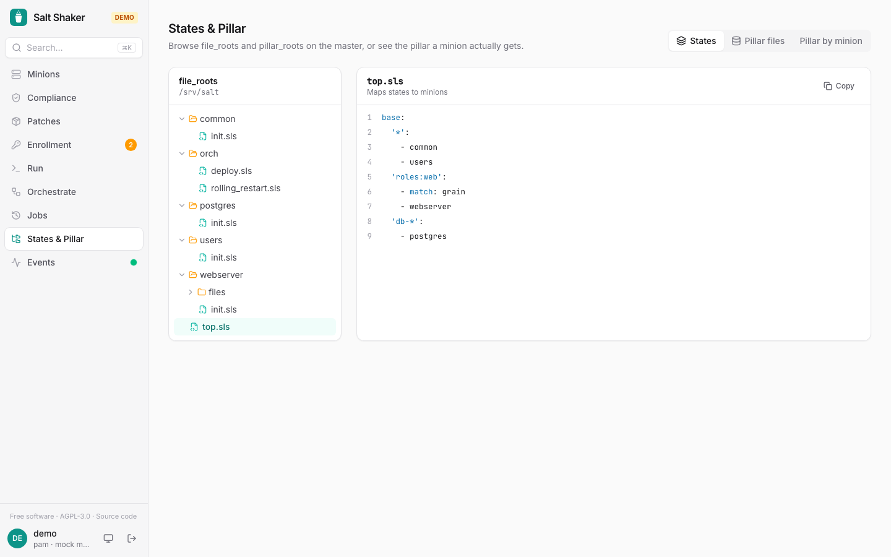

## Jobs

**Jobs** shows full results of past jobs. From a job you can *run it again*, retry only the minions that failed or didn't return, or download the results as CSV or JSON.

**Running now**, at the top, lists the jobs minions are still working on (`jobs.active`, which asks every minion, so it takes a few seconds). **Stop** ends a job on the minions still running it with `saltutil.kill_job`, after a confirmation. Those minions return no result, and a state run stopped midway may leave some states applied and others not. Viewers see running jobs but can't stop them, and every stop is in the audit log.

The master keeps jobs for about 24 hours. With the server, jobs are recorded from the event bus and kept for 90 days by default (`JOB_RETENTION_DAYS`). That includes jobs run from the salt CLI, along with who ran them.

## Events

**Events** shows the master's event bus live, with filters. Toasts pop up for failed jobs and for minions waiting for approval.

## States & Pillar

Browse `file_roots` and `pillar_roots` with syntax highlighting.
