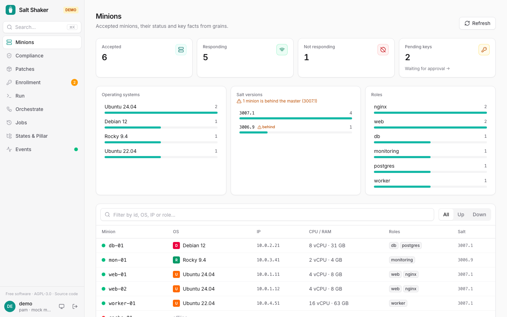

The **Minions** page shows status, OS, IPs, CPU/RAM and roles of every minion. A fleet breakdown flags minions running an older Salt than the master.

Each minion's page shows its grains and compiled pillar. Viewers don't see pillar data, since it often holds secrets.

Offline minions are detected the way the Salt CLI does it, with `saltutil.find_job` and a short `gather_job_timeout`.

Press **⌘K** / **Ctrl+K** anywhere to jump to a page, minion, saved target or recent command.
