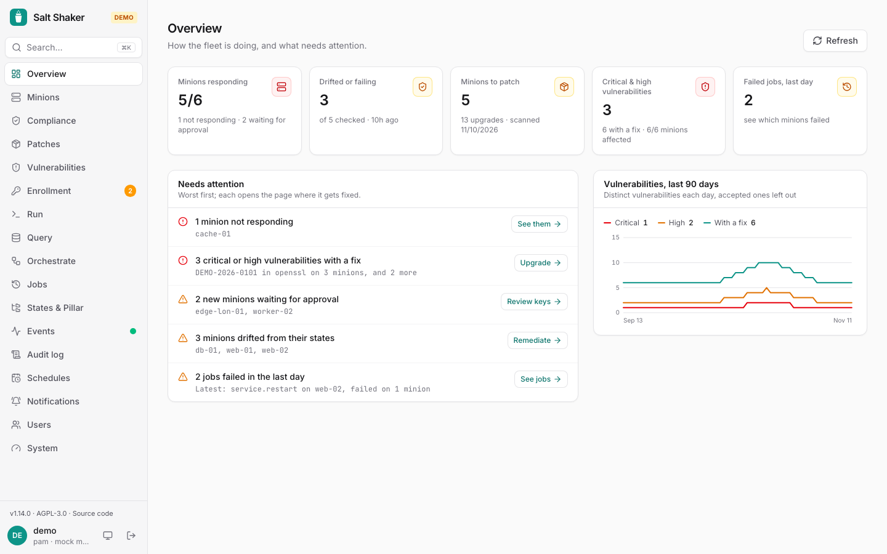

**Overview** is the home page: how the fleet is doing at a glance, and a short list of what needs someone's attention, worst first.

## The numbers

Each one opens the page behind it:

- **Minions responding**: accepted minions that answered the last `manage.status`, how many didn't, and new keys waiting for approval. It fills in once the slow minions have answered.
- **Drifted or failing**: minions whose latest [compliance check](/salt-shaker/guide/compliance/) found drift or an error, and when that was.
- **Minions to patch**: minions with pending upgrades from their latest [patch scan](/salt-shaker/guide/patches/).
- **Critical & high vulnerabilities**: from the [vulnerability report](/salt-shaker/guide/vulnerabilities/), with how many have a fix. Accepted risks are left out.
- **Failed jobs, last day**: jobs that failed on at least one minion.

## Needs attention

What to look at, critical first, each with a button to the page where it's dealt with:

| Level | When |
| --- | --- |
| Critical | minions aren't responding; the highstate fails on a minion; a critical vulnerability has a fix |
| Warning | new minions wait for approval; minions drifted from their states; a high vulnerability has a fix; jobs failed in the last day |
| Info | no compliance check or vulnerability scan in a week; accepted risks end within a week; minions have pending upgrades (when no fixable vulnerability is listed already) |

When nothing is listed, it says *All clear*. The 90-day vulnerability trend is next to the list.

Compliance, patches, vulnerabilities and failed jobs are recorded by the server. Without it ([direct mode](/salt-shaker/deploy/direct-mode/)), the overview shows minions and keys only. The minions list itself moved to **Minions** (`/minions`); old links with its filters still open it.
