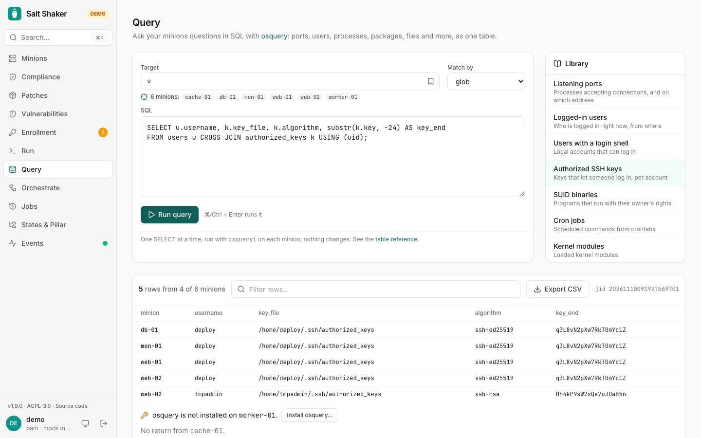

**Query** runs an [osquery](https://osquery.io) SQL query on a target and shows the answers of every minion as one table, with a `minion` column first. Ask about listening ports, users, SSH keys, processes, kernel modules, packages, files and [much more](https://osquery.io/schema/).

## Running a query

Pick a target, write a query or choose one from the **Library**, and **Run query** (or press ⌘/Ctrl + Enter). **Query** on a minion's page opens the page with that minion as the target. Filter the rows as they come in, and **Export CSV** downloads the rows the filter shows. The last query's results stay on the page when you open a minion and come back. Click a column header to sort by it (numbers sort as numbers); click again to reverse.

**Copy link** copies a link that opens the page with this query and target, to send to a colleague. Queries from the library and the team's saved ones are also in ⌘K: type part of the name, e.g. *ssh keys*.

**Group identical rows** shows each distinct row once, with how many minions have it and which, rarest first. What sets a few minions apart from the rest comes to the top: an extra account, an SSH key nobody expected, a port only one server listens on. The CSV export then has `count` and `minions` columns instead of `minion`.

Only one `SELECT` (or `WITH … SELECT`) runs at a time, and nothing on the minion changes. Each minion runs `osqueryi --json` through `cmd.run`, with the query on standard input, so it needs permission for `cmd.run`; viewers can't run queries. Every query is in the [audit log](/salt-shaker/guide/users-audit/#audit-log) and the job history like any other call.

The library has ready-made queries for listening ports, logged-in users, accounts with a login shell, authorized SSH keys, SUID binaries, cron jobs, kernel modules, the processes using the most memory, and the OS with its uptime.

## Saved queries

With the server, operators and admins save a query for the team with **Save for the team**. Saved queries are listed at the top of the library for everyone; whoever saved one (or an admin) can replace it by saving under the same name, or remove it.

## Watching a query

An admin can run a query on a schedule with **Watch…**, or with an [osquery schedule](/salt-shaker/guide/schedules/). Each run is compared with the previous one, minion by minion: rows that appeared or went away are counted, the schedule shows them (*+2 −1 on 2 minions*, with **What changed in the last run** listing them), and the **Query changes** notification lists up to ten of them, e.g. `web-02: + username=tmpadmin shell=/bin/bash`. The first run is the baseline and doesn't alert.

Good candidates are queries whose answer should stay the same: listening ports, accounts with a login shell, authorized SSH keys, SUID binaries, cron jobs, kernel modules. Leave out columns that change by themselves (PIDs, times, memory use), or every run looks different. A minion's result over 512 KB isn't kept in the job history, so it can't be compared; narrow the query if the schedule says so.

## Installing osquery

Minions without osquery are listed under the results. **Install osquery…** adds the official osquery repository (`pkg.osquery.io`, signed with its own key) and installs the `osquery` package with apt (Debian, Ubuntu) or dnf/yum (RHEL, AlmaLinux, Rocky Linux). It starts no daemon; queries use the `osqueryi` shell. Alpine and other systems aren't covered.

To install it with your own states instead, add the same repository to your `pkgrepo.managed` states and `pkg.installed: osquery`.
