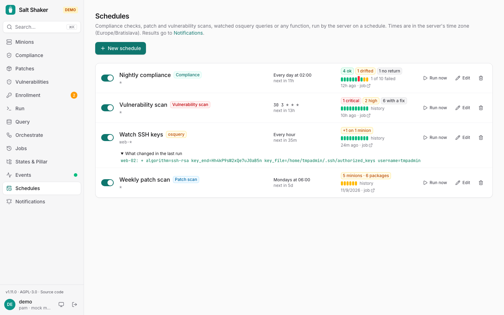

Both pages need the server, and only admins manage them; the demo has a few to try, kept in the browser.



## Schedules

**Schedules** runs jobs on a cron schedule:

- **Compliance check**: `state.apply test=True`, the same as the [Compliance](/salt-shaker/guide/compliance/) page.
- **Patch scan**: `pkg.list_upgrades`, the same as [Patches](/salt-shaker/guide/patches/).
- **Vulnerability scan**: lists the installed packages for [Vulnerabilities](/salt-shaker/guide/vulnerabilities/).
- **osquery query**: runs a [Query](/salt-shaker/guide/query/#watching-a-query) and compares its rows with the previous run, so you hear about a new port, account or SSH key. **Watch…** on the Query page starts one from the query you're looking at.
- **Any function**, with arguments, for example `saltutil.sync_all`. **Schedule…** on the [Run](/salt-shaker/guide/run/) page starts one from the function and target you're about to run.

You can pick a preset such as *Every day at 02:00* or *Weekdays at 06:00*, or write your own cron expression. Times use the server's time zone; in the container, set it with `TZ`.

Each schedule shows when it runs next, a summary of its last run with a link to the job, and a **Run now** button. Below the summary, a bar for each of its last 10 runs shows how they went: green ok, amber drifted (or updates available), red failed, gray when some minions did not return. Hover a bar for the details or click it to open that job; the link next to them opens all of the schedule's jobs. Scheduled jobs appear in history and in the audit log as `schedule:<name>`, so renaming a schedule starts its list of runs anew.

:::note
With several server instances on one database, each scheduled run still starts exactly once.
:::

## Notifications

**Notifications** sends alerts to webhooks. Each channel picks which events it gets:

| Event | When |
| --- | --- |
| Drift | a scheduled compliance check found drifted minions or errors |
| Patches | a scheduled patch scan found upgrades |
| Vulnerabilities | a scheduled vulnerability scan found critical or high vulnerabilities that an upgrade fixes |
| Query changes | a scheduled osquery query returned rows that weren't there last time, or lost some |
| Risk acceptances | an accepted vulnerability risk ends within 3 days, and again when it has ended |
| Every scheduled run | any schedule finished, with its summary |
| Failed jobs | a job failed on any minion; failures of one job are combined into one alert |
| Pending keys | a new minion is waiting for approval; at most once every 6 hours per minion |
| Minions down | a minion missed two checks in a row (`manage.status`, every 5 minutes by default), and again once it answers |
| Weekly report | Mondays at 8:00, server time: how the fleet did over the last seven days |

Minions that are already down when the server starts are not reported, only the ones that go down while it is watching. Set `PRESENCE_CHECK_MINUTES` to change the interval, or to `0` to turn the check off.

### Weekly report

For people who don't open the console every day, the **Weekly report** sums up the last seven days in a few lines: how many minions are accepted, not answering and quiet for 30+ days; jobs run and failed; changes rolled out, stopped and waiting for approval; critical and high vulnerabilities with the change since a week earlier; and how many commands came from the console and the API, by how many people. It goes out on Mondays at 8:00 in the server's time zone (set `TZ` on the container to pick yours), once per week, to the channels that tick it. The Notifications page shows it as it stands now, with **Send now**.

There are three formats:

- **Slack-compatible**, for Slack incoming webhooks. Mattermost and Rocket.Chat accept it too, and so does Discord if you append `/slack` to its webhook URL.
- **Microsoft Teams**, an Adaptive Card with a link back. In Teams, add the *Post to a channel when a webhook request is received* workflow to the channel (channel **⋯ → Workflows**) and paste the URL it gives you. The older Office 365 connectors are retired and are not supported.
- **Generic JSON webhook**, for anything else:

```json
{
  "source": "salt-shaker",
  "event": "job_failed",
  "severity": "error",
  "title": "cmd.run failed on 2 minions",
  "lines": ["Minions: web-01, web-02", "Started by: otto"],
  "url": "https://salt.example.com/jobs/20261101192517728905",
  "at": "2026-11-01T19:25:33.211Z"
}
```

### Signed webhooks

Each generic JSON webhook gets a signing secret when it's added. It's shown once, then only as *signed*; **New secret** makes another, and the old one stops working right away. Webhooks added before 1.13 are *unsigned* until you click **Sign**.

Every request carries two headers:

- `X-Salt-Shaker-Timestamp`: when it was sent, in Unix seconds
- `X-Salt-Shaker-Signature`: `sha256=` and the HMAC-SHA256 of `<timestamp>.<raw body>` with the secret, hex encoded

The receiver recomputes the signature over the raw body, compares it in constant time, and rejects old timestamps (say, more than five minutes) so a captured request can't be replayed:

```js
import { createHmac, timingSafeEqual } from 'node:crypto'

function verify(secret, headers, rawBody) {
  const ts = Number(headers['x-salt-shaker-timestamp'])
  if (!ts || Math.abs(Date.now() / 1000 - ts) > 300) return false
  const want = 'sha256=' + createHmac('sha256', secret).update(`${ts}.${rawBody}`).digest('hex')
  const got = String(headers['x-salt-shaker-signature'] ?? '')
  return got.length === want.length && timingSafeEqual(Buffer.from(got), Buffer.from(want))
}
```

```python
import hashlib, hmac, time

def verify(secret: str, headers: dict, raw_body: bytes) -> bool:
    ts = headers.get("X-Salt-Shaker-Timestamp", "")
    if not ts.isdigit() or abs(time.time() - int(ts)) > 300:
        return False
    want = "sha256=" + hmac.new(secret.encode(), f"{ts}.".encode() + raw_body, hashlib.sha256).hexdigest()
    return hmac.compare_digest(want, headers.get("X-Salt-Shaker-Signature", ""))
```

Slack and Teams webhooks aren't signed; their secret is the URL itself.

The **Test** button sends a test message. If a channel fails, its last error is shown next to it.

Webhook URLs contain secrets, so the UI only shows enough of them to recognize which is which. To change one, enter a new URL.
