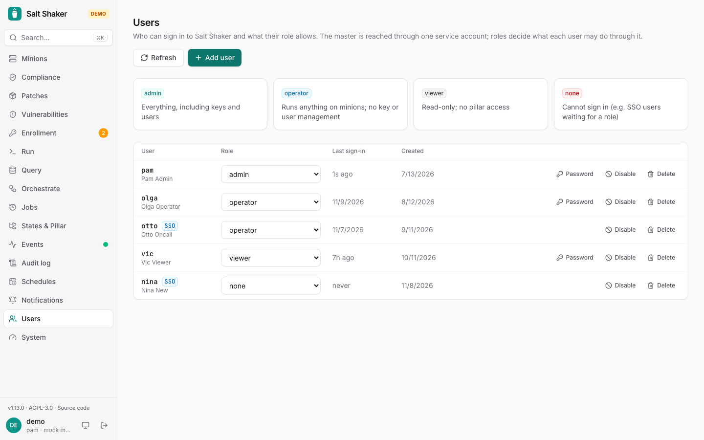
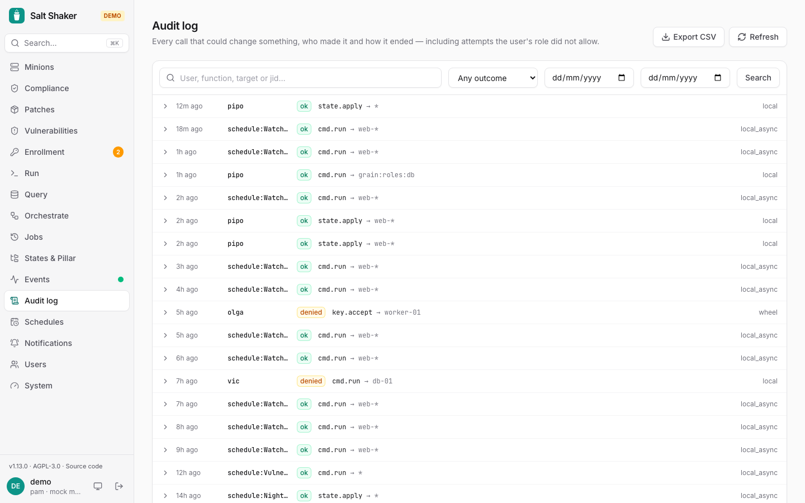

## Users

Admins invite people and manage accounts on the **Users** page. Each account has one [role](/salt-shaker/reference/roles/): *admin*, *operator*, *viewer* or *none*. An operator can also be [limited to some minions](/salt-shaker/reference/roles/#limiting-what-someone-can-run-on) under **Can run on**. No Linux accounts are needed on the master.

A username is a short name (3–32 characters: letters, digits, `.`, `_`, `-`) or an email address. Existing accounts keep their names; usernames can't be changed, so to switch someone to an address, add a new account and delete the old one. The audit log keeps the old name on past entries.

With [single sign-on](/salt-shaker/deploy/sso/), users are created on their first sign-in and marked with the provider's name. They have no password here. When roles come from the provider's groups, they can't be changed on this page.

To stop someone from signing in, give them the *none* role, disable them, or delete them.

**Last sign-in** shows when each user last signed in, with a password or through SSO, which helps with access reviews. Sign-ins are recorded from version 1.5.0 on, so users who haven't signed in since the upgrade show *never*.

The first admin is created on the first visit to a fresh install.

### Inviting someone

**Invite user** asks for a username, a role, for an operator optionally the minions they're limited to, and how long the link is valid (1, 7 or 30 days). You get a link to send them. Whoever opens it chooses their own password and is signed in, so no password is ever made up by an admin or sent around. The limit applies from their first sign-in.

A link works once and is shown only when it's made: the server keeps a hash of it, not the link. Invitations that haven't been accepted are listed under the users. **New link** replaces a lost or expired one (the old link stops working) and **Revoke** withdraws the invitation. Opening a used, revoked or expired link says only that it isn't valid any more.

Invitations are in the audit log: `user.invite`, `user.renew_invite`, `user.revoke_invite`, and `user.accept_invite` when the account is created.

With single sign-on and `PASSWORD_LOGIN=admins`, only admins can be invited: everyone else has no password here and comes in through the provider.

### Two-step verification and passkeys

Everyone sets these up for themselves under **Sign-in security**:

- **Two-step verification** asks for a 6-digit code from an authenticator app (TOTP) after the password. Setting it up shows a QR code and ten one-time backup codes; nothing is asked at sign-in until a first code from the app was confirmed. On the sign-in page, **Don't ask on this browser for 30 days** skips the code on that browser, and **Use a backup code** signs in without the app. Turning it off or making new backup codes takes the password again.
- **Passkeys** sign in with a fingerprint, face, device PIN or a security key instead of the password: **Sign in with a passkey** on the sign-in page. A passkey sign-in asks for no code. Passkeys need HTTPS (or localhost) and are bound to the host name in `PUBLIC_URL`, so they stop working if that host name changes.

Accounts that come in through single sign-on have no password here; their second step is the identity provider's.

On the **Users** page, *2-step* and a passkey count mark the accounts that have them. For a lost phone or key, **Reset sign-in** removes a user's two-step verification and passkeys and signs them out everywhere; their password still works and they can set both up again (`user.reset_sign_in` in the audit log).

## Audit log

The **Audit log** records every change, plus every denied attempt (the demo has one too, of what you do in it), with who, what, where (client IP) and the resulting jid.

Besides Salt calls, it has the console's own changes: schedules and notification channels (`schedule.*`, `notification.*`), and vulnerabilities accepted or withdrawn (`vulns.accept` with the reason and duration, `vulns.unaccept`).

Search by user, function, target or jid, and narrow the list by outcome (ok, denied, error) or by date. Dates are whole days in UTC, both ends included. **Export CSV** downloads every entry that matches the current filter, up to 100,000 rows, with times in ISO 8601 UTC and arguments as JSON. Only admins and operators can see or export the log. The search goes into the page's address, e.g. `/audit?outcome=denied&from=2026-11-01`, so you can bookmark it or send it to someone.

Entries are kept forever unless you set `AUDIT_RETENTION_DAYS`, e.g. `365` to keep one year. Older entries are deleted every 6 hours. Export what you need to keep longer first. The **System** page shows the setting.

Salt's own job cache records the user too, in the job metadata as `salt_shaker_user`.
