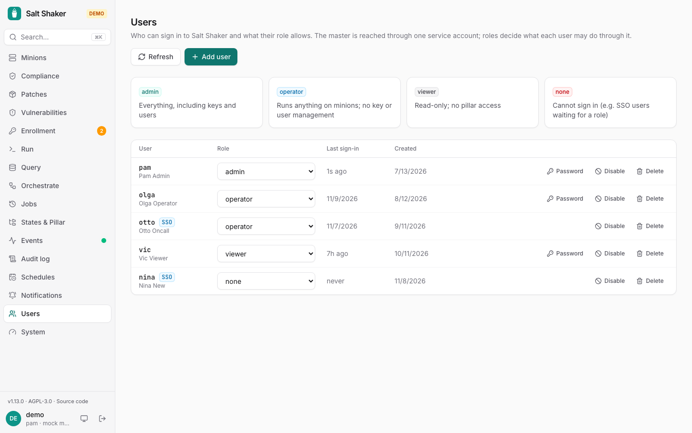
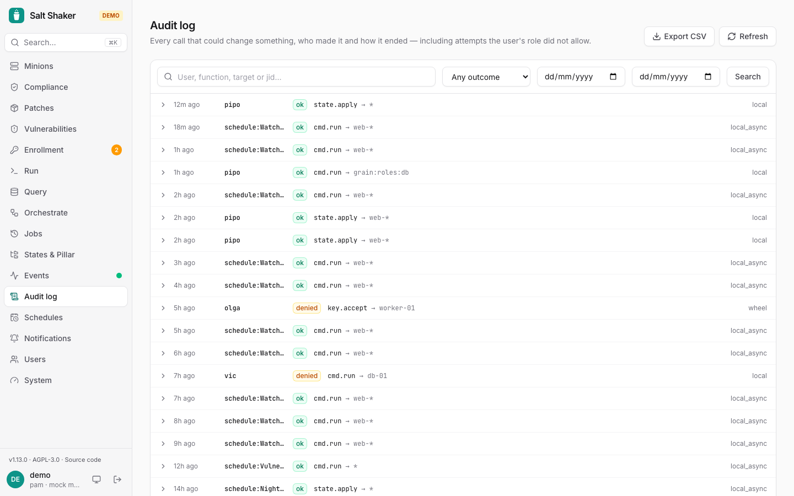

## Users

Admins create and manage accounts on the **Users** page. Each account has one [role](/salt-shaker/reference/roles/): *admin*, *operator*, *viewer* or *none*. No Linux accounts are needed on the master.

With [single sign-on](/salt-shaker/deploy/sso/), users are created on their first sign-in and marked with the provider's name. They have no password here. When roles come from the provider's groups, they can't be changed on this page.

To stop someone from signing in, give them the *none* role, disable them, or delete them.

**Last sign-in** shows when each user last signed in, with a password or through SSO, which helps with access reviews. Sign-ins are recorded from version 1.5.0 on, so users who haven't signed in since the upgrade show *never*.

The first admin is created on the first visit to a fresh install.

## Audit log

The **Audit log** records every change, plus every denied attempt (the demo has one too, of what you do in it), with who, what, where (client IP) and the resulting jid.

Besides Salt calls, it has the console's own changes: schedules and notification channels (`schedule.*`, `notification.*`), and vulnerabilities accepted or withdrawn (`vulns.accept` with the reason and duration, `vulns.unaccept`).

Search by user, function, target or jid, and narrow the list by outcome (ok, denied, error) or by date. Dates are whole days in UTC, both ends included. **Export CSV** downloads every entry that matches the current filter, up to 100,000 rows, with times in ISO 8601 UTC and arguments as JSON. Only admins and operators can see or export the log. The search goes into the page's address, e.g. `/audit?outcome=denied&from=2026-11-01`, so you can bookmark it or send it to someone.

Entries are kept forever unless you set `AUDIT_RETENTION_DAYS`, e.g. `365` to keep one year. Older entries are deleted every 6 hours. Export what you need to keep longer first. The **System** page shows the setting.

Salt's own job cache records the user too, in the job metadata as `salt_shaker_user`.
